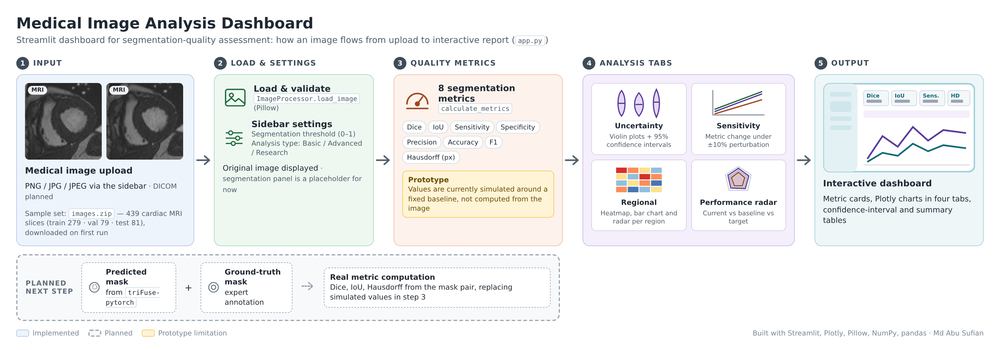

# Medical Image Analysis Dashboard

A Streamlit-based dashboard for medical image analysis with advanced visualization and analysis capabilities.

> **Related project:** this dashboard is being developed as the evaluation companion to [triFuse-pytorch](https://github.com/datascintist-abusufian/triFuse-pytorch) - the TriFuse-SRNet reference implementation for scribble-supervised cardiac MRI segmentation. The goal is to score and inspect segmentation masks (Dice, IoU, Hausdorff distance, uncertainty, sensitivity and regional performance).

> **Current status - prototype.** The interface, layout and visualisations are in place, but the metric values are **simulated placeholders** (`ImageProcessor.calculate_metrics` in `app.py` generates them around a fixed baseline with random noise). They are not computed from the uploaded image or from TriFuse-SRNet outputs. Computing the metrics from predicted and ground-truth mask pairs is the next step.

## Block diagram



**Figure 1.** How an image moves through `app.py`: upload (PNG/JPG; sample cardiac MRI slices from `images.zip`) → load and sidebar settings → eight segmentation-quality metrics → four analysis tabs (uncertainty, sensitivity, regional, performance radar) → interactive dashboard. The dashed row shows the planned step: computing the metrics from a TriFuse-SRNet predicted mask and its ground-truth mask, replacing the simulated values.

## 🌟 Features

- **Image Analysis**
  - Upload and process medical images
  - Support for PNG, JPG, JPEG formats
  - DICOM support coming soon

- **Advanced Analytics**
  - Uncertainty Analysis
  - Sensitivity Analysis
  - Regional Performance Analysis
  - Performance Radar Visualization

- **Key Metrics**
  - Dice Score
  - IoU Score
  - Sensitivity/Specificity
  - Precision/Accuracy
  - F1 Score
  - Hausdorff Distance

## 🚀 Quick Start

### Prerequisites

- Python 3.8 or higher
- pip package manager

### Installation

1. Clone the repository:
```bash
git clone https://github.com/datascintist-abusufian/medical-image-analysis.git
cd medical-image-analysis
```

2. Create and activate a virtual environment (recommended):
```bash
# Windows
python -m venv venv
venv\Scripts\activate

# macOS/Linux
python3 -m venv venv
source venv/bin/activate
```

3. Install required packages:
```bash
pip install -r requirements.txt
```

### Running the Application

```bash
streamlit run app.py
```

## 📊 Dashboard Components

1. **Image Upload & Display**
   - Original image view
   - Segmentation result visualization
   - Support for multiple image formats

2. **Metrics Display**
   - Metric cards for key metrics (currently simulated placeholder values; see *Current status* above)
   - Interactive visualization
   - Comparative analysis

3. **Advanced Analysis**
   - Uncertainty Analysis with confidence intervals
   - Sensitivity Analysis with perturbation plots
   - Regional Performance Analysis with heatmaps
   - Performance Radar with baseline comparison

## 💻 Usage

1. Launch the application using `streamlit run app.py`
2. Upload a medical image using the sidebar
3. Adjust analysis settings as needed
4. View various analyses through the interactive tabs
5. Export or save results as needed

## 📂 Project Structure

```
medical-image-analysis/
├── app.py               # Main application file
├── requirements.txt     # Python dependencies
├── README.md            # Project documentation
└── data/                # Data directory (created automatically)
    └── heart_dataset_sup/
```

## 🛠️ Technical Details

### Built With
- [Streamlit](https://streamlit.io/) - The web framework used
- [Plotly](https://plotly.com/) - Interactive visualizations
- [OpenCV](https://opencv.org/) - Image processing
- [NumPy](https://numpy.org/) & [Pandas](https://pandas.pydata.org/) - Data processing

### System Requirements
- RAM: 4GB minimum (8GB recommended)
- Storage: 500MB free space
- CPU: Multi-core processor recommended

## 📋 Data Format

The dashboard currently supports:
- PNG images
- JPG/JPEG images
- DICOM support coming soon

## 🤝 Contributing

1. Fork the repository
2. Create your feature branch (`git checkout -b feature/AmazingFeature`)
3. Commit your changes (`git commit -m 'Add some AmazingFeature'`)
4. Push to the branch (`git push origin feature/AmazingFeature`)
5. Open a Pull Request

## 📄 License

This project is licensed under the MIT License - see the [LICENSE](LICENSE) file for details.

## 📞 Contact

Md Abu Sufian - [LinkedIn](https://www.linkedin.com/in/tacticalbusinessintelligence/) | [Google Scholar](https://scholar.google.com/citations?user=8ozStcUAAAAJ&hl=en) | [GitHub](https://github.com/datascintist-abusufian)

Project link: https://github.com/datascintist-abusufian/medical-image-analysis

## 🙏 Acknowledgments

- Being developed to support evaluation of the TriFuse-SRNet segmentation work in [triFuse-pytorch](https://github.com/datascintist-abusufian/triFuse-pytorch)
- Metric definitions follow standard practice for medical image segmentation evaluation (Dice, IoU, Hausdorff distance)
- Built with Streamlit, Plotly, OpenCV, NumPy and Pandas

## 🔄 Updates & Version History

- v1.0.0 (Current)
  - Initial release
  - Basic image analysis functionality
  - Advanced visualization features

## 📝 Citation

If you use this software in your research, please cite:

```bibtex
@software{sufian_medical_image_analysis,
  author = {Sufian, Md Abu},
  title  = {Medical Image Analysis Dashboard},
  year   = {2024},
  url    = {https://github.com/datascintist-abusufian/medical-image-analysis}
}
```

## ⚠️ Disclaimer

This software is for research and educational purposes only. Not intended for clinical use or medical diagnosis.
