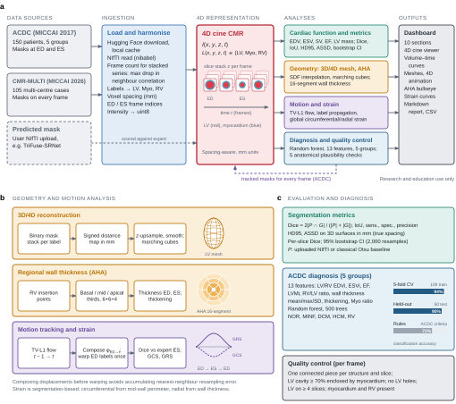

# 4D Cardiac MRI Analysis Dashboard

A Streamlit dashboard for exploring public **4D cine cardiac MRI** (3D + time) with expert segmentations, and for computing **real segmentation-quality metrics** and **cardiac function** from them.

**Live app:** https://abusufian-medical-image-analysis-pro.streamlit.app/



**Figure 1 | 4D cardiac MRI analysis dashboard.** **a**, Pipeline from the public datasets (ACDC, CMR-MULTI) and optional predicted masks, through loading and label harmonisation, to the 4D image and label volumes and four groups of analyses shown in the dashboard. **b**, Geometry and motion: shape-based interpolation and marching cubes for 3D/4D meshes, RV-insertion-referenced AHA 16-segment wall thickness, and TV-L1 optical-flow tracking with composed displacements for label propagation and global strain. **c**, Evaluation and diagnosis: segmentation metrics with bootstrap confidence intervals, a random-forest ACDC classifier (94% 5-fold CV on 100 training patients, 90% on 50 held-out patients, vs 72% for the published ACDC rules), and anatomical quality-control checks.

> **Related project:** this dashboard is the evaluation companion to [triFuse-pytorch](https://github.com/datascintist-abusufian/triFuse-pytorch), the TriFuse-SRNet reference implementation for scribble-supervised cardiac MRI segmentation. Upload a predicted mask and it is scored against the expert masks.

## 🫀 Data

The app downloads cases on demand from Hugging Face. No imaging data is stored in this repository; `data/` holds only small case catalogues (IDs, diagnostic group, ED/ES frame, height/weight, reported LVEF).

| Source | Cases | What is 4D | Expert masks | Licence |
|---|---|---|---|---|
| **ACDC** (MICCAI 2017) | 150 patients, 5 groups: NOR, MINF, DCM, HCM, RV | Short-axis cine, ~10 slices × 12–35 frames | LV cavity, myocardium, RV cavity at ED and ES | CC BY-NC-SA 4.0 |
| **CMR-MULTI** (MICCAI 2026) | 105 multi-centre patients | Short-axis cine, ~11 slices × 25–30 frames | LV cavity, myocardium, RV cavity on **every frame** | CC BY-NC 4.0, academic use only |

* ACDC: Bernard O., Lalande A., Zotti C., Cervenansky F. *et al.* "Deep Learning Techniques for Automatic MRI Cardiac Multi-structures Segmentation and Diagnosis: Is the Problem Solved?" *IEEE Transactions on Medical Imaging* 37(11):2514–2525, 2018. doi:[10.1109/TMI.2018.2837502](https://doi.org/10.1109/TMI.2018.2837502). Official site: https://www.creatis.insa-lyon.fr/Challenge/acdc/ (loaded from the unmodified mirror `MedOtter/ACDC`).
* CMR-MULTI: Universal Multi-Sequence, Multi-Center and Multi-View CMR Segmentation Challenge, 1st Workshop on Medical World Models, MICCAI 2026. BAAI and Beijing Anzhen Hospital. https://mwm2026.github.io/cmr-multi · https://huggingface.co/datasets/TaipingQu/CMR-MULTI

CMR-MULTI stores each cine series as slices × frames stacked along one axis. The app finds the frame count from the drop in image correlation at slice boundaries and reshapes the series to 4D.

## 🌟 Features

| Section | What it does | Method / reference |
|---|---|---|
| **4D viewer** | Browse slices and cardiac phases, play the cine loop of any slice, see all slices with LV/myocardium/RV overlays | – |
| **Cardiac function** | LV/RV EDV, ESV, SV, EF; LV mass; BSA-indexed values (ACDC); volume–time curves (CMR-MULTI) | voxel counting, Mosteller BSA |
| **Segmentation metrics** | Dice, IoU, sensitivity, specificity, precision, volume error, HD95, ASSD; per-slice, bootstrap and temporal analysis; CSV export | uploaded NIfTI mask or classical baseline |
| **3D/4D reconstruction** | Triangle meshes of LV, myocardium and RV at any frame, 4D heartbeat animation, surface area and sphericity | shape-based interpolation (Raya & Udupa 1990) + marching cubes; cf. MeshHeart (Qiao et al., *Nat Mach Intell* 2025) |
| **Regional (AHA)** | Wall thickness at ED and ES and systolic thickening in the 16 AHA segments, as bullseye plots; count of segments > 15 mm | RV-insertion-referenced segmentation as in the Imperial UK Biobank pipeline (Bai et al. 2018, 2020) |
| **Motion & strain** | Dense TV-L1 optical-flow tracking, composed displacement fields, ED→all-frame label propagation, Dice of the tracked masks against held-out expert masks, global circumferential and radial strain | Zach et al. 2007; registration-based tracking as in UK Biobank strain analysis |
| **Diagnosis** | Random forest on 13 segmentation-derived features for the 5 ACDC groups: 94% 5-fold CV on the 100 training patients, 90% on the 50 held-out test patients; PCA map; rule-based ACDC criteria for comparison | Isensee et al. 2017; Khened et al., *MedIA* 2019 |
| **QC & report** | Anatomical plausibility checks and a downloadable structured report with ACDC-criterion flags | quality-control idea from Oxford's 2026 accountable-AI CMR DPhil |
| **Imaging guide** | How cine CMR is acquired and read, what each measurement means, ACDC criteria, reference-range sources, pitfalls | Kawel-Boehm et al., *JCMR* 2020 |
| **Research & data** | Current Oxford DPhil and Imperial projects mapped to the methods implemented here; data sources and licences | – |

`data/acdc_features.csv` is computed from the expert masks by `scripts/build_acdc_features.py` and holds features only, no images.

## 🚀 Quick start

```bash
git clone https://github.com/datascintist-abusufian/medical-image-analysis.git
cd medical-image-analysis
python3 -m venv venv && source venv/bin/activate   # Windows: venv\Scripts\activate
pip install -r requirements.txt
streamlit run app.py
```

Each case downloads once (about 5–20 MB) and is then cached in `/tmp/hf_cardiac_cache`.

## 📂 Project structure

```
medical-image-analysis/
├── app.py                        # Streamlit app: data loading, viewer, function, metrics
├── advanced.py                   # 3D/4D, AHA, motion & strain, diagnosis, QC & report, guide
├── analysis.py                   # algorithms (meshes, AHA thickness, TV-L1 tracking, strain, QC, features)
├── scripts/build_acdc_features.py
├── requirements.txt
├── data/
│   ├── acdc_catalog.csv          # ACDC case list (no images)
│   ├── cmr_multi_catalog.csv     # CMR-MULTI case list (no images)
│   └── acdc_features.csv         # diagnostic features from expert masks (no images)
└── docs/
```

## 🛠️ Built with

Streamlit · Plotly · NiBabel · SciPy · scikit-image · scikit-learn · NumPy · pandas · huggingface_hub

## 📄 License

The code is MIT licensed; see [LICENSE](LICENSE). The imaging data stay under their own licences, listed above, and are for non-commercial research use.

## 📞 Contact

Md Abu Sufian - [LinkedIn](https://www.linkedin.com/in/tacticalbusinessintelligence/) | [Google Scholar](https://scholar.google.com/citations?user=8ozStcUAAAAJ&hl=en) | [GitHub](https://github.com/datascintist-abusufian)

## 🔄 Version history

- **v2.1.0**: 3D/4D mesh reconstruction, AHA regional analysis, TV-L1 motion tracking and strain, ACDC diagnosis model, QC and automated report, imaging guide, research context.
- **v2.0.0**: 4D cine MRI from ACDC and CMR-MULTI, 4D viewer, cardiac function, and metrics computed from real mask pairs, replacing the simulated values of v1.
- **v1.0.0**: prototype dashboard with simulated metrics.

## 📝 Citation

If you use this software, please cite it and the datasets above:

```bibtex
@software{sufian_medical_image_analysis,
  author = {Sufian, Md Abu},
  title  = {4D Cardiac MRI Analysis Dashboard},
  year   = {2026},
  url    = {https://github.com/datascintist-abusufian/medical-image-analysis}
}
```

## ⚠️ Disclaimer

For research and education only. Not for clinical use or medical diagnosis.
